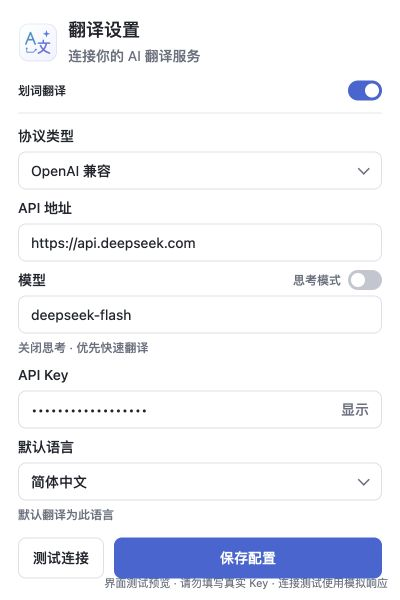
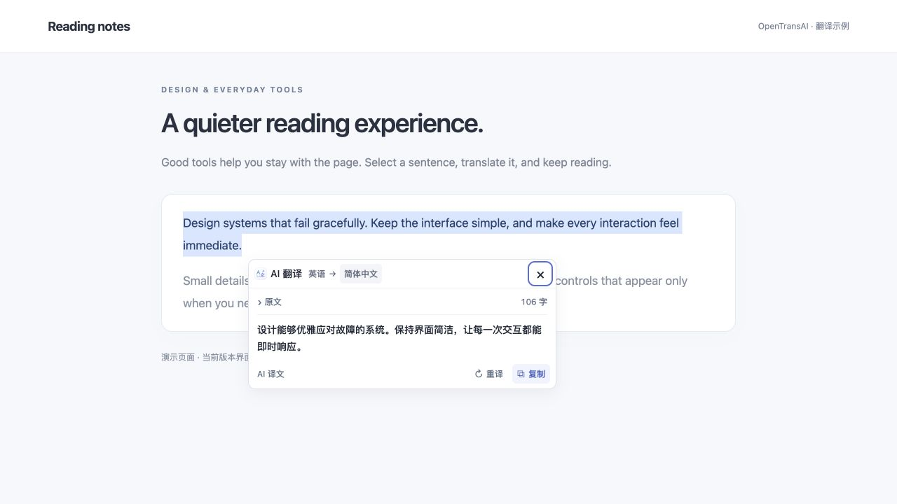

<p align="center">
  
</p>

<h1 align="center">OpenTransAI</h1>

<p align="center">简洁的 Chrome AI 划词、图片与截图翻译扩展</p>
<p align="center"><strong>轻量交互 · AI 直连 · 隐私优先</strong></p>

选中文字后点击翻译按钮，或在图片上右键选择“OpenTransAI · 翻译图片”，译文直接出现在当前页面；也可通过框选截图翻译图片文字。使用你自己的 AI 服务、模型和 API Key，无需注册项目账号，无需部署项目后端。

**直连你配置的 AI 服务，无项目后台，无中转。** OpenTransAI 不设自有后台服务器，翻译请求由浏览器扩展直接发送到你指定的 AI 接口，API Key 和翻译内容不经过项目方服务器。翻译需要所配置的 AI 服务提供支持；使用云端 AI 时，选中文字或明确选中的图片内容会发送给对应服务商。

## 设计目标

| 目标 | 实现方式 |
| --- | --- |
| **简洁** | 划词显示 26px 纯图标按钮，图片使用原生右键菜单；在当前页面查看译文，在工具栏弹窗中完成配置。 |
| **直连无中转** | 扩展直接请求你配置的 AI 服务，不依赖项目自有后台，Key 与翻译内容不经过项目方服务器。 |
| **隐私安全** | 自带 API Key，直接连接指定 AI 服务；不经过项目中转，不采集翻译历史，不做遥测或云同步。 |

## 界面预览

以下为原有划词版本的界面截图；图片翻译增加了目标语言选择、展开阅读及取消操作。截图配置使用示例值，译文使用演示数据，不包含真实 API Key。

### 配置弹窗

点击工具栏图标即可配置 AI 服务、模型、思考模式和默认语言，保存后自动关闭。配置页高度随内容适应，常规设置与连接提示完整展示，无内部滚动区。

<p align="center">
  
</p>

### 划词翻译示例

在网页中选中英文，点击翻译按钮，即可在当前页面查看中文译文。原文默认折叠，底部提供重译和复制操作。

<p align="center">
  
</p>

## 使用体验

- **按需翻译**：仅选中文字不会发送请求，点击翻译按钮后才调用 AI。
- **自动选择方向**：识别原文语言，自动在默认语言和英语之间切换。
- **流式显示**：收到片段即显示，减少等待完整结果的时间。
- **轻量浮窗**：默认约 440px 宽，高度不超过可视窗口的 70%，靠近边缘时自动调整位置。
- **专注阅读**：原文默认折叠并显示字数；原文和译文共用一个正文滚动区，顶部语言栏和底部操作固定。
- **随手操作**：复制、重译、点击浮窗外部或按 `Esc` 关闭；支持浅色与深色页面样式。点击“固定”后可在网页上继续操作并保留浮窗，Esc 或关闭按钮仍可关闭，新翻译任务恢复默认未固定状态。
- **自由配置**：自选协议、API 地址、模型和 Key；保存后配置弹窗自动关闭。
- **明确等待状态**：显示读取图片、识别、翻译等真实阶段；15 秒无进展提示等待较长，60 秒无响应或有效内容增量时超时；支持 DeepSeek 官方接口的思考开关。

## 安装与开始使用

需要 **Chrome 123 或更高版本**。直接加载源码无需 Node.js，也无需安装依赖。

1. 下载或克隆本仓库，并解压到本地。
2. 打开 `chrome://extensions`，开启右上角的 **开发者模式**。
3. 点击 **加载已解压的扩展程序**，选择仓库内的 **`extension` 文件夹**。
4. 点击 Chrome 工具栏中的 OpenTransAI 图标，填写 **协议类型、API 地址、模型、API Key、默认语言**。
5. 点击 **保存配置**，按提示允许访问你填写的 AI 服务地址。也可通过 **测试连接** 检查当前配置。
6. 刷新网页，选中文字后点击翻译按钮，或在图片上右键选择“OpenTransAI · 翻译图片”。

### X 帖子原位翻译

- 在 X / Twitter 网页的文字帖子中显示“AI 翻译”。有原生翻译控件时追加在其后，没有时显示在正文上方；回复与引用帖分别翻译。
- 点击后才发送当前帖子已加载的正文，等待时保留原文，完成后原位显示译文；点击“显示原文”恢复原始正文与链接。再次查看复用当前页面内存缓存，正文或配置改变后重新翻译。
- 已被 X 自动翻译的帖子先通过原生“显示原文”取得正文；无法确认原文时提示重试。长帖展开后使用更新的正文，单次仍限制 12,000 字符。
- 使用现有已保存的模型和自动语言方向。多个帖子与划词浮窗的任务互相独立，共享五个活动任务上限；失败、重试和配置引导显示在帖子内。
- 关闭翻译总开关会恢复原文并移除入口；重新启用后恢复入口。此适配只处理帖子文字，图片文字继续使用图片翻译。
- 更新后重新加载扩展并刷新 X 页面。站点结构可能随 X 更新而变化；本地交互测试不代表登录后真实 X 页面或实际模型请求验收。

### 图片与截图翻译

- 在图片上打开浏览器原生右键菜单，选择“OpenTransAI · 翻译图片”。网页右键入口仅在图片上显示，普通文字、链接和空白区域不显示插件菜单。不限制图片显示尺寸；仅打开或取消菜单不会读取或上传图片。
- 图片不显示悬停按钮，不注册图片鼠标移动监听、DOM 观察器或悬停计时器。普通图片、`picture/srcset`、动态加载和透明图片元素均按浏览器选定来源处理，不依赖网站域名或类名。
- 若网站拦截了原生菜单，或内容属于 CSS 背景、画布等浏览器无法提供图片菜单的区域，右键点击浏览器工具栏中的扩展图标，选择“框选截图翻译”。
- 图片原文与译文按原图结构整理：标题、段落、列表、清晰表格和代码分区显示；多栏按阅读顺序组织，不补写或概括内容。表格关系不清时逐行保留并提示，宽表可在表格内横向查看。复制保留段落、编号与制表符列，不带排版标记。
- 图片宽度造成的正文折行，会要求模型先还原自然段，再整段翻译；译文随浮窗宽度自动折行。保留真正的段落、列表项、表格行、诗歌、地址和代码换行，边界不明确时保留；这依赖模型判断，不能保证所有图片都能正确合并。
- 图片先识别完整原文，再按自动方向翻译：原文与默认语言相同则译为英语，否则译为默认语言，与划词规则一致。第二步直接接收译文正文，由扩展补齐已知语言信息，避免正文中的引号、换行或反斜杠因 JSON 转义问题阻断翻译。重译、重试翻译阶段和临时切换语言复用原文。手动选择目标语言时尊重该选择；若原文与最终目标语言仍相同（包括默认英语的英语图片），直接展示并允许复制。
- 图片识别使用当前配置的服务、模型和 Key，模型必须支持视觉输入。文字“测试连接”通过不代表支持图片。
- 跨域图片无法读取时可主动授权对应图片域名，或选择框选截图；不会自动截图。
- 通过扩展图标右键菜单的“框选截图翻译”使用当前标签页临时授权。网页浮窗需要额外截图权限时，打开独立授权界面，由用户点击授权；拒绝后原任务保留。配置页只展示翻译设置，不提供截图按钮或截图权限区。
- 拖动选区后可以确认、重新选择或 Esc 取消；确认前原任务继续处理，取消恢复窗口。截图只上传本地裁剪后的选区。切页、滚动、缩放等变化会要求重新框选。
- 默认浮窗宽 440px、高度不超过视口 70%，展开为右侧 520px 阅读窗；默认点击浮窗外部会关闭结果并取消当前请求；点击“固定”可保留结果，取消固定后恢复默认行为，浮窗内部操作保持可用。重新划词后，点击翻译按钮开启新任务；框选截图期间不会误关闭旧任务。
- 流式内容默认跟随；向上阅读时停止跟随，可点“回到最新”。取消或断流保留已生成部分，支持“复制已有内容”；复制失败会选中文本并提示手动复制。
- 图片归一为 PNG/JPEG 单帧，载荷上限 4MiB、单边 8000px、原文 12000 字符。动图仅处理单帧；表格按行回退。超限或服务截断会提示缩小范围，不自动分片。

更新扩展文件后，请先在 `chrome://extensions` 中点击 **重新加载**，再刷新需要翻译的网页。

## 接入 AI 服务

| 协议 | 可接入的服务 | 地址填写方式 |
| --- | --- | --- |
| OpenAI 兼容 | OpenAI、DeepSeek、自定义兼容服务或本机模型服务 | 填写基础地址，例如 `https://api.deepseek.com/v1`；自动追加 `/chat/completions`。 |
| Anthropic | Anthropic API | 填写基础地址，例如 `https://api.anthropic.com/v1`；自动追加 `/messages`。 |
| Google Gemini | Gemini API | 填写基础地址，例如 `https://generativelanguage.googleapis.com/v1beta`。 |

**模型名称填写对应服务实际可用的 Model ID。** 图片识别、划词翻译和连接测试需要支持 JSON 输出；图片识别后的翻译使用正文输出。即时显示分片还需要服务端支持 SSE 流式响应。模型权限、费用和可用名称以所选服务为准。

切换协议类型会保留当前填写的 API 地址、模型、API Key 和默认语言，保存后生效。设置页与翻译浮窗统一支持 16 种目标语言。

未保存修改会单独暂存在当前浏览器会话中，重新打开设置页时自动恢复，包括尚未填完整的内容；“放弃修改”恢复已保存配置。“测试连接”只验证当前输入，成功后仍需点击“保存配置”才会生效。草稿不参与实际翻译、不做云同步，仅扩展可信页面可访问；浏览器退出或扩展重新加载、更新、停用后草稿清除。

OpenAI 兼容和 Anthropic 也可以填写完整的上述接口地址。远程地址要求 HTTPS；本机服务允许使用 `localhost`、`127.0.0.1` 或 `[::1]` 的 HTTP 地址。

### 使用本机模型

如果希望翻译请求留在设备上，可以自行运行兼容的本机模型服务，然后配置：

```text
协议类型：OpenAI 兼容
API 地址：http://127.0.0.1:端口/v1
模型：本机服务提供的模型 ID
API Key：本机服务要求的 Key；不校验时可填写 local
```

将 `端口` 替换为实际端口。插件不内置模型；只有模型服务也在本机处理且不向外转发时，翻译内容才可留在本机。

### 划词自动翻译规则

默认语言初始为 **简体中文**，可以在配置中修改。

| 原文的主要语言 | 翻译为 |
| --- | --- |
| 与默认语言不同 | 默认语言 |
| 与默认语言相同 | 英语 |

例如，默认中文时：英语 → 中文，日语 → 中文，中文 → 英语。简繁中文及同一语言的地域变体按同一种语言处理；默认语言为英语时，目标语言始终为英语。

## 隐私与数据流向

```text
选中文字 → 点击翻译 → 浏览器扩展 → 你配置的 AI 服务 → 当前页面显示译文
```

**没有 OpenTransAI 中转环节。数据去向由你的 AI 配置决定。**

- **本地保存配置**：API Key 与设置保存在当前 Chrome 配置文件的 `chrome.storage.local`，不做云同步。存储区仅允许扩展可信页面访问，网页内容脚本不能读取 Key。
- **按需发送内容**：图片识别请求携带选定图片或裁剪截图，文字翻译请求携带原文、翻译指令、语言和模型配置，Key 用于向指定服务认证。不上传整页内容、网页地址或浏览历史。
- **不建立用户档案**：无项目账号、广告、遥测或持久化翻译历史；图片、识别结果及译文只保留在当前标签页内存，重新触发图片会读取实际像素并核对摘要；不加载远程可执行代码。
- **限制请求与渲染**：AI 地址在保存或测试时按需授权；请求不携带浏览器 Cookie、不跟随重定向。译文按纯文本显示。
- **连接测试可预期**：点击“测试连接”会向当前配置的 AI 服务发送固定短句 `Hello, world!`，不会自动保存配置。

使用云端模型时，服务商仍会收到翻译请求，其数据保留和使用规则由服务商决定。本地存储不是加密密钥链，拥有该浏览器配置文件访问权限的人仍可能读取 Key；请勿将真实 Key 写入源码或提交到 GitHub。

自动显示划词按钮需要扩展在 HTTP(S) 网页运行内容脚本；AI 服务域名的网络权限在保存或测试配置时申请。可以通过配置窗口的 **翻译功能** 总开关随时关闭功能。

## 常见问题

**更新扩展后提示 `Extension context invalidated` 或 `getURL` 不可用？**

扩展重新加载、更新或停用后，已打开网页中的旧脚本可能仍在运行，但原来的扩展接口已失效。请重新加载更新后的扩展，再刷新需要翻译的网页。旧页面已经执行的脚本不会因文件更新而自动替换。

当前版本在检测到上下文失效后停止旧任务，移除翻译按钮、浮窗和截图遮罩，并清理事件及定时器；不会因再次划词反复报错或弹出错误窗口。后台暂时连接失败仍可重试。此类失效发生时无法再访问扩展存储，不会尝试写入后台诊断日志；Chrome 错误列表中的历史记录需要手动清除。

**怎样定位图片识别或翻译失败？**

重新加载扩展并刷新网页后，复现一次问题；打开工具栏的翻译设置，点击右上角 **诊断日志**，再点击 **刷新**。日志页支持查看诊断字段、复制和清空；自动复制失败会选中内容供手动复制。

异常日志只保存在当前 Chrome 配置文件，保留最近 100 条、最多 7 天，打开日志或新增异常时清理过期记录。记录请求编号、失败阶段、协议、模型、配置版本、HTTP 状态、耗时，以及空正文、代码围栏、非法 JSON、字段结构等原因；能取得时附带解析位置和字段类型。识别、翻译、连接测试、后台读图和截图失败会记录，成功及主动取消不记录。

日志不保存 API Key、请求头、网址、图片、原文、译文、完整接口响应或原始错误堆栈，不上传或同步。历史异常无法补录；日志用于定位失败环节和格式特征，不能还原模型返回全文。安装前已经发生的问题需要重新复现。

图片识别兼容完整 JSON 外层的 Markdown 代码围栏（`json` 或无语言标记），去除包装后仍严格检查识别字段、文字长度和服务完成状态。缺失结束围栏、夹带说明、多段结果或字段错误不会作为成功结果；完整围栏内仍有问题时，诊断会显示实际的 JSON 或字段错误。更新前记录的围栏错误不会被改写，需要重新翻译确认。

图片第二步翻译的正文不再进行 JSON 解析，其检查失败记录为 `translation / result_text`；空正文、非法类型、长度超限、服务截断、断流和超时仍会报错。API 外层响应与 SSE 数据仍须符合所选协议。正文中真实出现的 JSON 示例和代码围栏会保留，不按协议包装猜测、截取或修补。

**为什么流式翻译开始前仍有停顿？**

服务连接、模型排队和思考都可能影响首段响应时间。扩展在收到译文片段后立即显示，不人为延迟。思考开关默认关闭，目前仅适用于 DeepSeek 官方地址的 OpenAI 兼容接口；开启后显示基于实际事件的阶段说明，不展示或保存原始推理文本。如果服务端只返回完整响应，译文会在响应到达后显示。

**哪些页面可以使用？**

支持普通 HTTP(S) 网页文本及常见文本输入区域，密码框不会触发。Chrome 内部页面、扩展商店、浏览器内置 PDF 阅读器及部分特殊编辑器不支持；普通网页图片可识别，canvas 内容可主动框选截图；未申请 `file://` 页面访问权限。

**长文本或请求失败时会怎样？**

单次选区上限为 12,000 个字符。断流会保留已显示片段并标记未完成，可点击重译。关闭翻译框会取消当前请求，旧结果不会覆盖新的选区。

## 开发

原生 HTML、CSS 和 JavaScript，采用 Chrome Manifest V3，无第三方运行依赖。

开发与检查需要 **Node.js 18+**，打包还需要系统 `zip` 命令；无需运行 `npm install`。

```sh
npm test         # 语言规则、协议、流式响应与后台消息边界
npm run check    # 清单、JavaScript 语法、CSP 与图标资源
npm run preview  # 本地交互预览：http://127.0.0.1:4173/
npm run package  # 输出 dist/OpenTransAI/ 和 dist/OpenTransAI.zip
```

预览页使用实际界面代码和独立的 Chrome / AI 测试适配器，不连接真实 AI 服务；不要在预览中填写真实 Key。打包产物不包含测试适配器。使用打包产物时，解压 ZIP 后加载其中的 `OpenTransAI` 文件夹。

```text
extension/          可直接加载的 Chrome 扩展
  content.js        单任务编排与跨帧来源路由
  popup.*           工具栏配置窗口
  lib/              统一浮窗、图片入口、框选、协议及后台处理
  icons/            浅色图标与保留的原暗色资源
tests/              核心测试及浏览器交互测试
scripts/            检查、预览与打包工具
docs/               设计说明与验证记录
```

查看 [图片交互规范](docs/image-translation-interaction-spec.md)、[图片翻译验收记录](docs/image-translation-verification.md)及[历史验证记录](docs/verification.md)。
