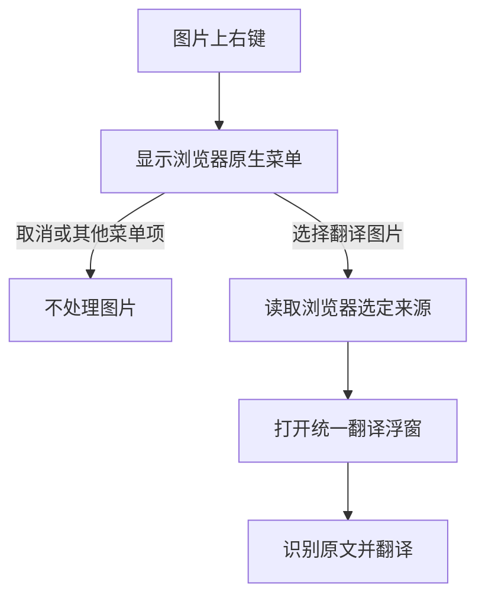
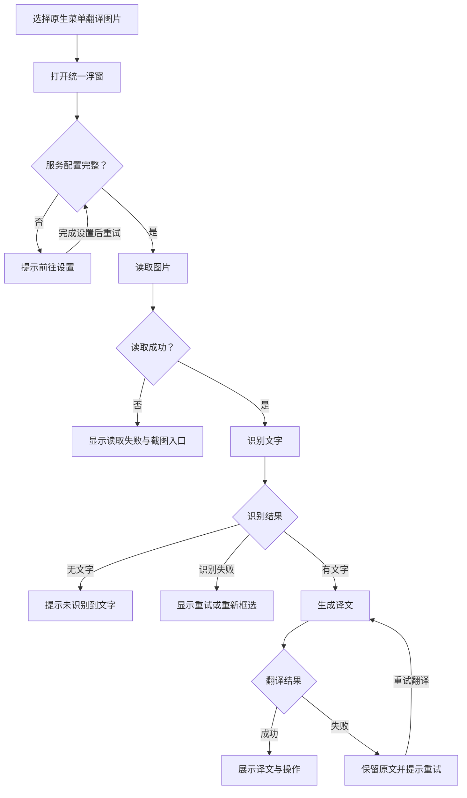
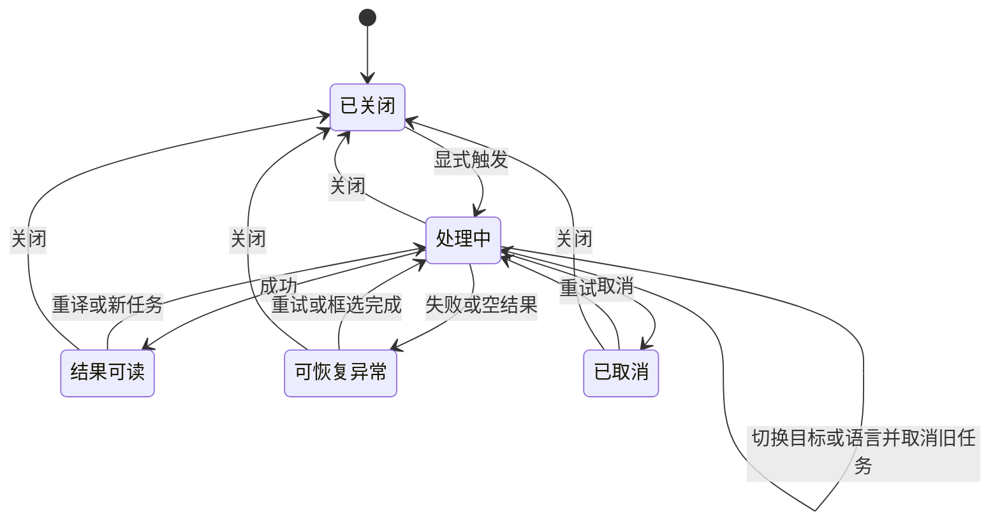
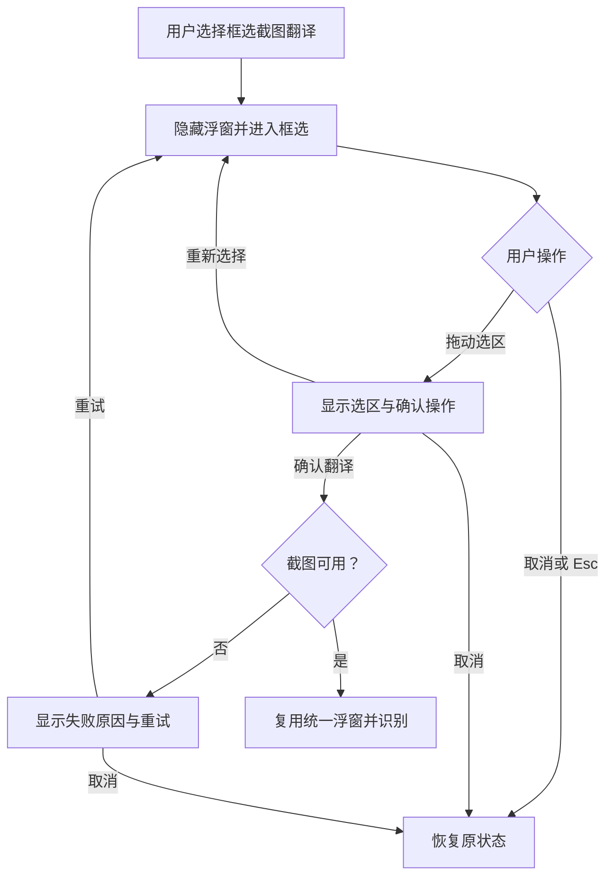

# Chrome AI 翻译插件：图片翻译交互规范

版本：1.0 · 日期：2026-09-17 · 状态：已按用户后续要求改为右键图片入口；本修订覆盖原图片悬停方案。

## 1. 设计结论与适用范围

图片翻译采用「原生右键选择“OpenTransAI · 翻译图片” → 打开统一翻译浮窗 → 识别图片文字 → 显示译文」的流程，与划词翻译共用浮窗组件。

原网页图片不替换、不覆盖译文、不改变尺寸或排版。不再采用此前原型中的“原图／译图切换”方案。划词按钮和图片右键菜单只承担入口作用，所有进度、结果和异常都在浮窗内展示。

本规范覆盖图片右键入口、任务状态、浮窗、长内容、错误恢复和截图兜底。划词翻译复用本文的浮窗及任务管理规则，跳过图片读取和文字识别阶段。AI 服务地址、Key、协议和默认目标语言沿用已有设置页。

本规范描述目标交互，不代表现有演示已实现 OCR、AI 请求、浏览器权限或截图能力。数值均为建议初始值，可根据实际使用调整。

## 2. 基本原则

1. **低干扰**：图片不显示悬停入口，不扫描或持续观察页面图片，不因鼠标移动调用识别或翻译服务。
2. **显式触发**：选择原生右键菜单中的“OpenTransAI · 翻译图片”后，才读取并处理所选图片；仅打开菜单不处理图片。
3. **一致性**：图片与划词结果使用同一浮窗布局、关闭方式和复制行为。
4. **可控性**：识别和翻译均能取消；失败后保留可恢复内容，不反复重做已经成功的步骤。
5. **不阻塞阅读**：浮窗为非模态窗口，不加全页遮罩；只有主动框选截图时进入临时遮罩模式。

## 3. 原生右键入口

- 在图片的浏览器原生右键菜单中增加“OpenTransAI · 翻译图片”，不替换或阻止原生菜单。
- 不限制图片显示尺寸，不按透明度、类名或网站域名过滤原生图片来源。
- 仅在用户右键时记录对应图片元素；浏览器菜单回调提供权威图片 URL，选择菜单项后才读取像素并打开统一浮窗。
- 页面图片已被替换或移除、无法定位元素时，使用浏览器明确选中的 URL，并按权限读取；浮窗在右上安全区域显示。
- 普通图片、`picture/srcset`、延迟加载、透明图片元素、iframe 使用同一处理逻辑。
- 网页右键翻译入口只在图片上显示；网站拦截原生菜单，或 CSS 背景、画布等区域没有浏览器图片菜单时，通过扩展图标右键菜单中的“框选截图翻译”处理。

## 4. 图片入口的事件边界

图片功能不注册鼠标移动监听、DOM 观察器、图片加载监听或悬停计时器。动态页面无需为新增图片补挂按钮。原有 120×60 阈值、300ms 显示、200ms 隐藏及图片按钮定位规则取消。

划词保留现有 26px 图标按钮；划词、图片和截图继续共用统一翻译浮窗。打开菜单、取消菜单、鼠标移动和页面变化均不读取图片、不调用 OCR。

## 5. 翻译主流程

### 5.1 首次触发

1. 锁定本次图片、触发位置和默认语言快照；识别后按自动方向确定目标语言：原文与默认语言相同则译为英语，否则译为默认语言。
2. 立即创建或复用浮窗，展示“正在读取图片…”，不等待请求完成才打开窗口。
3. 检查服务配置。缺少必要配置时显示“请先配置翻译服务”及“去设置”；不发起无效请求。
4. 读取图片；成功后进入文字识别阶段。
5. 确实可分离的识别阶段展示“正在识别图片文字…”。若后端一次调用直接完成图文翻译，统一展示“正在翻译图片…”，不模拟虚假的阶段进度。
6. 检测到文字后按阅读顺序整理，再生成译文；识别不到文字则进入明确的空结果状态。
7. 支持流式输出时逐步展示译文，完成前标记“翻译中”；不支持时保持进度提示，成功后一次展示。
8. 完成后显示完整译文和可用操作；图片本身不发生变化。

### 5.2 主流程图

取消、关闭与切换任务适用于所有处理中节点，统一规则见第 8 节。截图入口详见第 9 节。

### 5.3 源语言与目标语言

- 识别前源语言显示“自动检测”，成功后显示识别到的语言。
- 多语言图片显示“多语言”，按统一目标语言翻译，不强行标成英语。
- 目标语言切换后，新请求替换旧请求；保留上次结果作为过渡并明确标记“正在切换语言”，新结果到达后再替换。
- 仅改变目标语言时复用已成功识别的原文，不重复读取图片或识别。
- 浮窗内切换只影响当前任务；全局默认语言需在设置页修改。
- 未手动选择目标语言时，图片和截图沿用划词的自动方向：原文与默认语言相同（包括地域变体及简繁中文）则译为英语，否则译为默认语言。
- 手动选择目标语言时尊重该选择；文字与最终目标语言仍相同（包括默认英语的英语图片）时提示“图片文字已是目标语言”，直接提供识别文本及复制，不浪费一次翻译请求。

## 6. 统一翻译浮窗

### 6.1 内容结构

| 区域 | 内容与行为 |
| --- | --- |
| 顶部固定栏 | “AI 翻译”、源语言 → 目标语言、展开、固定、关闭 |
| 正文起始 | 识别完成后直接显示折叠原文；划词、图片与截图均不展示来源提示行 |
| 原文 | 默认折叠为“原文 · N 字”；展开显示识别文本，按阅读顺序排列 |
| 译文 | 主要阅读区域，支持选择、复制和合理段落结构 |
| 底部固定栏 | 当前状态、重译、复制；处理中将重译替换为取消 |
| 错误／空结果 | 在正文区域就地展示短提示和适当操作，顶部关闭始终可用 |

原文字符数只对已确认识别文本统计；识别完成前不显示占位字符数。未完成、取消或失败的部分译文，复制按钮标为“复制已有内容”，避免误以为是完整结果。

### 6.2 位置与大小

- 默认宽度 440px，可用宽度不足时收缩至视口宽度减去两侧各 12px 安全边距。
- 默认优先放在图片右侧；空间不足时依次尝试左侧、下方、上方。以不遮挡主要图片内容为目标，而非固定某一侧。
- 图片占满视口时允许浮窗覆盖图片，但仍保留屏幕边缘安全距离；不强行挤出页面横向滚动。
- 高度随正文增长，上限为当前可用视口的 70%。使用网格或弹性布局保证顶部、底部始终可见。
- 打开后固定在当前视口位置，页面滚动时不追逐图片；窗口缩放时仅做边界校正。
- 鼠标离开图片或浮窗不关闭；点击浮窗外部的网页区域（包括 iframe）自动关闭，并取消当前请求。浮窗内部操作、划词翻译按钮和框选截图不触发外部关闭。
- 顶栏提供“固定”切换，使用 `aria-pressed` 表达状态。固定后点击普通页面或 iframe 不关闭浮窗；取消固定恢复外部点击关闭。展开/收起、重试及语言切换保留当前固定状态，主动开启新任务重置为未固定。
- 点击关闭或按 Esc 关闭浮窗，固定状态不影响显式关闭。若语言菜单正在打开，Esc 先关闭菜单，再次 Esc 才关闭浮窗。

### 6.3 长文本阅读

- 使用正常字重；译文字号 14px、行高 1.6、段间距 8px 为初始值。
- 长原文默认折叠。原文展开后和译文共用一个正文滚动容器，不各自设置滚动条。
- 顶栏和底栏不参与正文滚动。正文滚动到边界时不连带滚动背景页面。
- 顶部“展开”切换为视口右侧的扩展阅读浮窗：宽度建议 520px，高度接近视口减去上下各 12px，仍是同一个任务和窗口，不新增第二层弹窗。
- 窄视口下展开模式使用可用宽度；收起与展开保留阅读位置、原文折叠状态和已生成内容。
- 流式生成时，只有用户停留在底部附近才自动跟随新内容；用户向上滚动立即停止跟随，显示“回到最新”。
- “回到最新”将正文滚到最新内容并恢复跟随；重译或切换任务才主动回到新内容起点。

## 7. 状态与文案

| 状态 | 显示内容 | 可用操作 |
| --- | --- | --- |
| 读取中 | 正在读取图片… | 取消、关闭 |
| 识别中 | 正在识别图片文字… | 取消、关闭 |
| 一体化处理 | 正在翻译图片… | 取消、关闭 |
| 翻译中 | 正在翻译…；已有内容逐步显示 | 取消、关闭；有文本时可复制已有内容 |
| 完成 | 完整译文；底部显示 AI 译文 | 复制、重译、语言切换、展开、关闭 |
| 已取消 | 已取消；保留已确认原文和已有译文，明确未完成 | 重试、复制已有内容、关闭 |
| 无文字 | 未识别到可翻译的文字 | 重新框选、关闭 |
| 无需翻译 | 图片文字已是目标语言 | 复制原文、语言切换、关闭 |
| 配置缺失 | 请先配置翻译服务 | 去设置、关闭 |
| 图片读取失败 | 无法读取这张图片 | 重试、框选截图翻译、关闭 |
| 服务异常 | 暂时无法完成翻译 | 重试、关闭；识别结果保留 |

### 7.1 等待和错误细则

- 请求超过 15 秒仍无新进展时追加“处理时间较长，你可以继续等待或取消”，不伪造百分比。
- 单次请求超过 60 秒无响应或流式输出连续 60 秒无新内容时进入超时状态，停止转圈并提供重试。阈值为建议值，需结合服务性能调优。
- 无效 Key：显示“认证失败，请检查 API Key”，操作“去设置”；不在提示里回显 Key。
- 额度或限流：显示“服务额度不足或请求过于频繁”，依据服务可区分的错误给出准确提示，不无休止自动重试。
- 模型不具备所需图片处理能力：显示“当前服务不支持图片识别，请更换服务”，不声称截图可以解决能力缺失。
- 识别模糊：标识“部分文字可能识别不准确”；不能识别的位置保留明确占位，不编造补齐。
- 复制失败：不要显示“已复制”；选中可复制文本并提示使用 Ctrl/Cmd+C。
- 仅翻译阶段失败时，“重试”复用原文；识别或读取失败时才重做对应上游步骤。
- 动图首版识别读取到的单帧；需要指定帧时提供框选截图入口，浮窗不展示固定的单帧提示行。

## 8. 多次触发、取消与任务隔离

同一个标签页同一时刻只有一个翻译浮窗和一个前台翻译任务。划词与图片翻译共用这一限制。

| 操作 | 处理规则 |
| --- | --- |
| 连续选择同一图片的翻译菜单 | 任务处理中只激活已有浮窗，不提交重复任务 |
| 同一图片已有成功结果 | 图片内容、语言和服务配置未变化时，可复用本标签页内存中的结果 |
| 通过右键翻译另一张图片或翻译另一段文本 | 取消前一个任务，用同一浮窗展示新任务；旧响应不得覆盖新内容 |
| 点击取消 | 尽可能中止请求；浮窗保留已生成内容，状态变为已取消 |
| 点击外部／关闭／Esc | 尽可能中止请求并关闭窗口；迟到响应不得重开窗口 |
| 点击重译 | 绕过译文缓存，使用现有识别文本重新翻译 |
| 改变目标语言 | 取消旧翻译，发起新语言请求，保留识别文本 |
| 图片地址未变但内容变化 | 以内容版本或摘要判断，不能仅依赖 URL 命中旧结果 |
| 切换其他标签页 | 不强制打开新窗口或抢焦点；回到原标签页后保留当前状态 |

取消在交互上立即生效，但不承诺服务端计算或计费一定同时停止。缓存仅为当前标签页短期内存，不默认建立持久化图片或翻译历史。

### 8.1 任务状态流程图

每次任务有独立标识。只有当前有效任务的响应能够更新浮窗；取消、关闭和任务切换均使旧任务失效。

## 9. 框选截图兜底

框选是主动操作，不因读取失败就自动截图。仅处理用户选中的区域；不把整个页面默认为翻译对象。

1. 用户点击“框选截图翻译”后，暂时隐藏翻译浮窗与按钮，避免它们出现在截图中。
2. 展示轻遮罩、十字光标和“拖动选择区域，Esc 取消”。
3. 用户拖动框选当前可见区域，出现选框尺寸及“翻译／重新选择／取消”。
4. 用户点击“翻译”后，结束遮罩并复用原浮窗。来源标记改为“截图翻译”，进入识别流程。
5. 空选区禁用“翻译”；极小选区提示扩大范围，按截图选区规则处理。
6. 按 Esc 或取消后回到原浮窗和原状态，不清空已有结果；从插件菜单独立启动时返回网页。
7. 当前页面或权限不允许截图时，明确提示并保留取消／关闭操作，不进入无限加载。
8. 截图只包含当前可见区域；超出视口的长图应提示用户打开完整图片后重试，不静默裁掉未显示部分。

## 10. 页面兼容、键盘和可访问性

- 插件样式与页面样式隔离，避免覆盖网站字体、滚动条和按钮。只有插件入口、浮窗和框选区域处理自身事件。
- 浮窗是带可访问名称的非模态对话区域，不能锁住网页键盘焦点；菜单项和按钮有“OpenTransAI · 翻译图片”“关闭”等明确名称。
- 通过键盘上下文菜单或插件菜单也能触发翻译，不要求用户操作图片悬浮按钮。
- 浮窗打开后焦点进入顶部操作区；点击关闭按钮或按 Esc 后恢复至触发控件或原页面合理位置，源元素失效时不报错；外部点击关闭时保留网页原生点击和焦点行为，不抢回旧焦点。
- 每个控件提供清晰焦点样式。语言下拉按原生键盘行为操作，不用颜色单独表达状态。
- 进度变化只播报阶段和完成情况，不逐字播报流式文本；错误使用明确可感知提示。
- 避免大幅位移动画和循环扫描装饰；用户设置减少动态效果时禁用非必要动画。
- 页面放大、窗口缩放、动态加载和图片移除时仍保持浮窗在视口内；任务已取得内容时，源图片移除不应丢失结果。
- 嵌入页面、受限页面或特殊渲染内容无法提供入口时，不伪造可用状态；按实际能力提供插件菜单或明确限制提示。

## 11. 实现边界与数据约定

以下为实现交互所需的最小约束，不限定具体框架：

- 鼠标移动和页面变化不执行图片检测。仅记录右键来源，不上传图片，不调用 OCR，不自动抓取全页内容。
- 图片内容只在用户触发后发送至已配置的识别／翻译服务；设置页应说明发送对象和用途。
- 配置页需指定实际使用的图片识别能力来源：支持视觉输入的模型，或独立 OCR 服务。仅有文本模型协议并不等于支持图片翻译。
- 请求必须关联当前任务标识、图片内容版本、服务配置版本及目标语言；不要把原始 Key 用作展示字段或日志内容。
- OCR 按原图阅读顺序整理标题、段落、列表、代码及表格，多栏各自成段，合并正文的视觉折行；诗歌、地址和代码保留必要换行。不总结、不新增标题或漏掉重复内容。
- 图片/截图原文与译文使用受限 Markdown 文本表达结构，前端仅创建固定的安全 DOM 元素，不执行 HTML、图片或链接。划词继续按纯文本展示。
- 明确表头与行列关系的表格展示为表格，保留空单元格、数字、单位和对应关系；无法可靠还原时改为逐行文本并提示，不推测表头或补齐数据。正文保留单一纵向滚动区，宽表在自身区域横向查看。
- 复制图片结果时导出可读文字：标题去标记，列表保留编号，表格转为制表符分列；原文字数不含排版标记。
- 长图片／长原文超过服务输入限制时，分段识别或翻译并保留顺序；不能静默截断后仍标为“完成”。无法分段时给出缩小范围的操作建议。
- 不在普通错误日志记录完整图片、原文、译文或 Key。该约束不改变正常复制操作。

## 12. 验收清单

| 编号 | 场景 | 预期 |
| --- | --- | --- |
| A01 | 任意显示尺寸的图片 | 无悬停按钮，可通过原生右键翻译 |
| A02 | 普通图片与透明图片元素 | 原生菜单选定来源后均可翻译 |
| A03 | 仅打开图片右键菜单 | 不读取图片、不调用识别或翻译 |
| A04 | 取消右键菜单或选择其他菜单项 | 不开启任务、不修改现有结果 |
| A05 | 页面持续新增、移除或修改图片 | 不安装 DOM 观察器、不触发自动请求 |
| A06 | 带链接的图片 | 普通点击保留链接行为，右键翻译不触发跳转 |
| A07 | 重复选择同一图片的翻译菜单 | 忙碌时只存在一个任务和一个浮窗 |
| A08 | 悬停图片 B，但未选择翻译菜单 | 不替换图片 A 已打开的结果 |
| A09 | 选择翻译图片 B | A 失效，A 的迟到响应不得覆盖 B |
| A10 | 小图右键翻译 | 正常打开浮窗，无显示尺寸阈值 |
| A11 | 缺少配置 | 提示去设置，不发起失败请求 |
| A12 | 图片没有文字 | 显示空结果提示，不生成臆测译文 |
| A13 | 阅读时移出图片或点击网页 | 移出保持打开；点击浮窗外部自动关闭，内部操作不关闭，框选期间保留旧任务 |
| A14 | 长原文和长译文 | 原文默认折叠，正文只有一个滚动区域，顶栏底栏可见 |
| A15 | 流式生成时向上滚动 | 停止自动追随，提供回到最新 |
| A16 | 切换目标语言 | 复用原文，只有最新任务结果生效 |
| A17 | 取消后响应到达 | 不继续更新已取消任务；部分文本标为未完成 |
| A18 | 关闭后响应到达 | 不重开浮窗、不弹出成功通知 |
| A19 | 图片读取失败 | 提供重试与主动框选入口，不自动截图 |
| A20 | 框选时按 Esc | 恢复原窗口及原状态，遮罩消失 |
| A21 | 翻译失败后重试 | 已识别原文保留，只重试必要阶段 |
| A22 | 复制权限不可用 | 不误报成功，提供手动复制 |
| A23 | 展开后再收起 | 内容、折叠状态、阅读位置保留 |
| A24 | 窗口缩小或页面缩放 | 浮窗仍在安全区域内，没有横向溢出 |
| A25 | 短时间在多张图片间移动 | 不出现图片悬停入口、不读取图片或发请求 |
| A26 | 图片内容改变但 URL 相同 | 不复用过期识别结果 |
| A27 | 原文与默认语言相同 / 手动选择同语言 | 默认自动转英语并可复用结果；手动同语言或默认英语的英语图片直接展示识别文本，无重复翻译 |
| A28 | 输入超出服务限制 | 明确分段或提示范围限制，不静默截断 |

## 13. 首版交付范围与后续扩展

**首版必须完成**：原生图片右键入口、动态图片来源、统一浮窗、真实处理状态、取消和关闭、原文折叠、长文本滚动、复制、重译、语言切换、请求隔离、基本错误提示，以及可用的框选兜底。

**长文阅读增强**：同一浮窗的展开模式、流式跟随控制；若首版时间受限可分阶段交付，但必须保留安全的高度限制和固定操作栏。

**后续可选**：框选后的局部修正、用户编辑识别原文、图片结果导出。均不影响本版“右键选择图片、结果在浮窗中”的核心模式。

**不包含**：自动扫描或翻译整页图片、替换原图、默认常驻按钮、多个叠加翻译弹窗、仅凭图片 URL 永久缓存结果。
